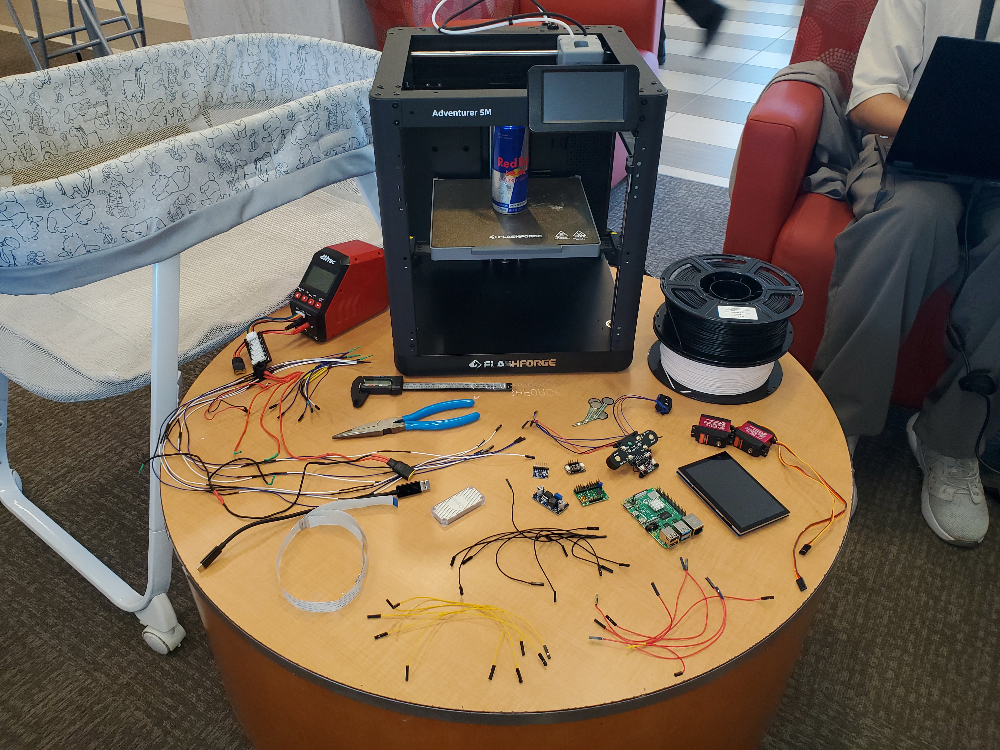
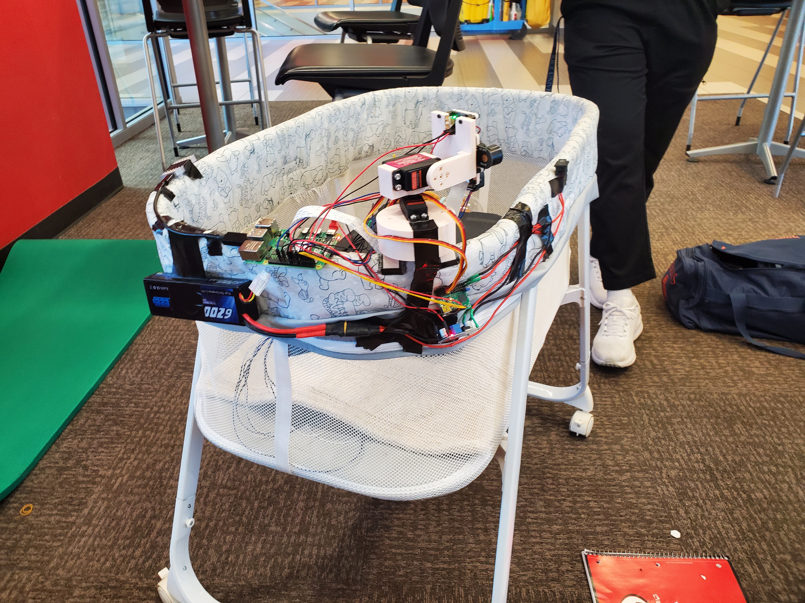
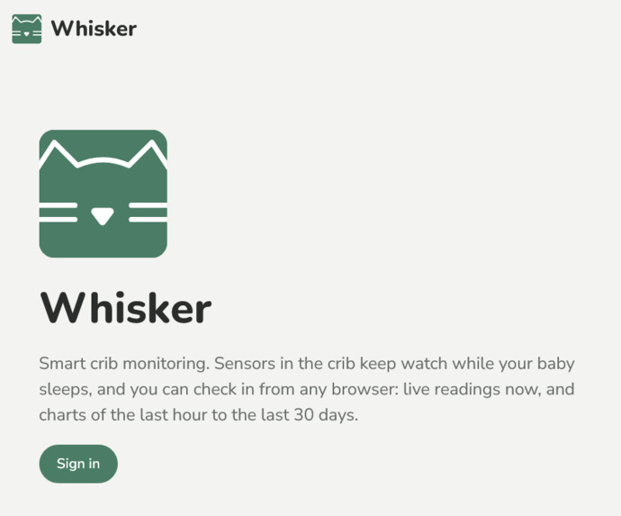
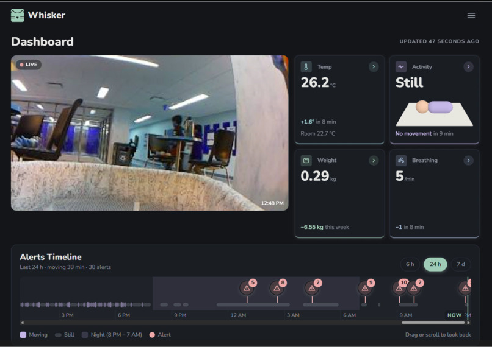
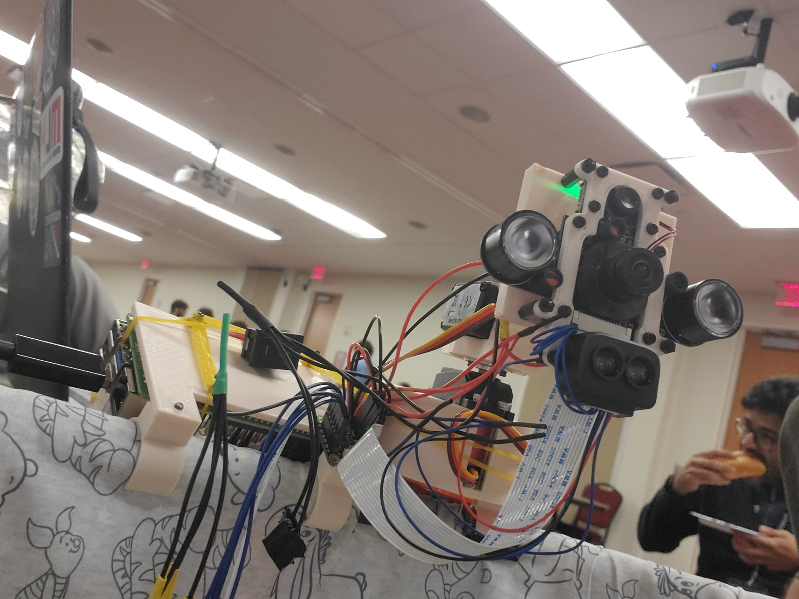
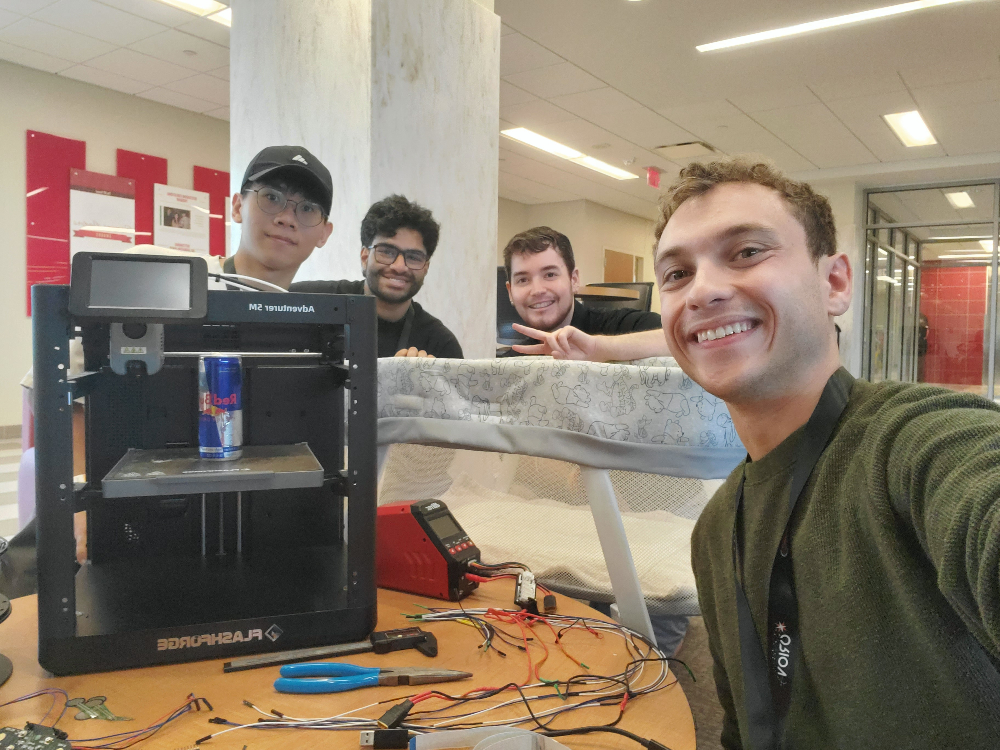
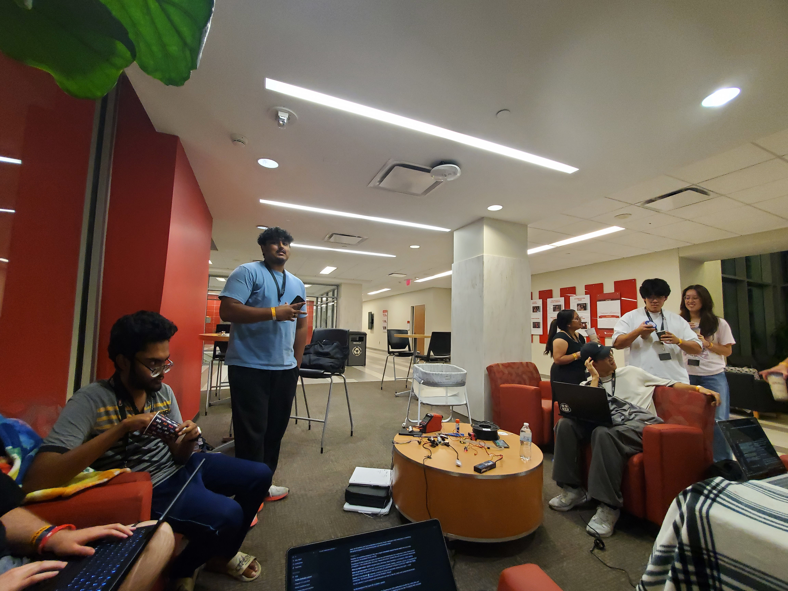
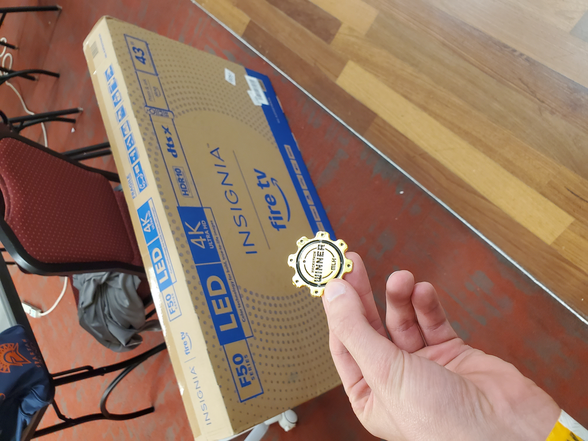

# [Whisker the Smart Crib](https://github.com/spengjohn/CodeRed-Orion)
### By [Matthew Thomas Beck](https://www.linkedin.com/in/matthewthomasbeck/), [Spencer Ennadi-Johnson](https://www.linkedin.com/in/spengjohn), [Vishnu Muthyalu](https://www.linkedin.com/in/vishnu-muthyalu), and [Hua-Ming Wu](https://www.linkedin.com/in/hua-ming-wu)

Click [here](https://devpost.com/software/whisker) for the Devpost

**Please consider:** if you like it, **star it!**

## Tech Stack
**Hardware**
- **Raspberry Pi** *(on-crib computer)*
- **Google Coral Edge TPU** *(on-device person / baby detection)*
- **OV5647** *(RGB camera)*
- **MLX90640** *(thermal camera)*
- **TF-Luna** *(LiDAR distance / presence)*
- **ADS1115** *(ADC for pressure-plate weight)*
- **Pololu Maestro** *(servo controller for camera tracking)*
- **3D-printed mounts** *(camera base, sensor array plate, pressure-plate feet, crib clips — see `3d_parts/`)*

**Software**
- **Edge (`edge/`):** C++17, CMake, libcamera, TensorFlow Lite / libedgetpu, libpq, POSIX threads
- **Backend (`backend/`):** Python, Flask, Flask-SocketIO, Auth0 (PyJWT), Tiger Data / PostgreSQL (`psycopg`), Twilio
- **Frontend (`frontend/`):** React, Vite, Auth0, Socket.IO client, Recharts, Three.js

## Project Components

### Edge — crib board (`edge/`)
The edge binary runs on the Pi at the crib. It samples sensors, runs local vision / tracking, uploads vitals, and streams IR video frames to the backend.

| Area | What it does |
| --- | --- |
| **VitalsHub** | Owns thermal (MLX90640), pressure ADC (ADS1115), LiDAR (TF-Luna), breath monitor, and ROI sampling |
| **PressurePlate** | Turns ADC readings into baby weight / presence |
| **BreathMonitor** | Estimates breaths per minute from the thermal / distance pipeline |
| **OV5647 + CameraFusion** | RGB capture and registration with the thermal frame |
| **IrStreamPipeline + UplinkClient** | JPEG frames over TCP to the backend video relay (`VIDEO_HOST` / `VIDEO_PORT`) |
| **BabyTrackPipeline + Coral + Maestro** | Edge TPU detection and servo centering on the baby when `TRACKING_ENABLED=1` |
| **TimeseriesClient** | Writes minute vitals snapshots to Tiger Data (PostgreSQL) |
| **Alert detectors** | Apnea, baby/ambient thermal, and bed-absence checks before uplink |

  
  

### Backend — API & realtime (`backend/`)
Flask serves REST history/latest readings, Auth0-protected Socket.IO live `vitals`, alert logging (with Twilio), and the edge video relay that rebroadcasts crib frames as `video_frame` events for the dashboard.

### Frontend — parent dashboard (`frontend/`)
React + Vite app for sign-in, live crib feed, metric cards (temperature, weight, breathing, activity), analytics charts, and alerts. Deployed as static files behind nginx at [whisker.health](https://whisker.health).

  
  

## Overview
Whisker is a smart crib monitor built for **CodeRED Orion**. Sensors on the crib track the baby's temperature, weight, breathing rate, and movement; an on-device Coral TPU can keep the camera pointed at the baby; and parents watch live vitals and video from the web dashboard.

  
  

The system is split so each layer has one job: the **edge** board owns hardware and local inference, the **backend** owns auth, storage, alerts, and fan-out, and the **frontend** owns presentation and preferences (°C/°F, kg/lb, theme). Together they turn a pile of sensors and 3D-printed mounts into a continuous infant-monitoring loop — from crib to cloud to parent phone or laptop.

  
  

